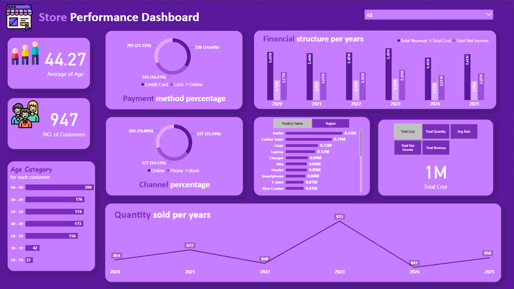

# Store Performance Dashboard

**An interactive Power BI dashboard that turns 947 transactions into clear insights on revenue, cost, and net income (2020-2025).**

Built with Power BI Desktop, Power Query, and DAX.

## Highlights
- **Data model:** purchases table linked to a products table (many-to-one on Product ID)
- **DAX:** 5 measures (Total Revenue, Total Cost, Total Net Income, Total Quantity, Avg Rate) plus calculated columns using RELATED and SWITCH
- **Field parameters:** switch the chart dimension (product or region) and the measure with one click
- **Power Query:** loaded from Excel and removed 35 rows (3.6%) with null or "Unknown" values
- **Interactive layout:** branch slicer, KPI cards, and 6 charts on a custom 1920x1080 page

## Key Insights
- 2.67M in revenue and 1.56M in net income from 5,196 units sold to 480 customers.
- Revenue peaked in 2023, dropped about 18% in 2024, and recovered about 8% in 2025.
- Kettle led net income (232,883), followed by Coffee Table and Chair.
- Revenue is evenly balanced across branches, channels, and payment methods (none above 37%).

## Dataset
Training dataset provided by the instructor of a data analysis training program, shared with permission. Amounts are in currency units. The original file is in the `data` folder.

## How to Use
1. Download [Store Performance Dashboard.pbix](Store Performance Dashboard.pbix) and open it in Power BI Desktop (Windows).
2. Use the branch slicer and the two field-parameter slicers to explore the data.
